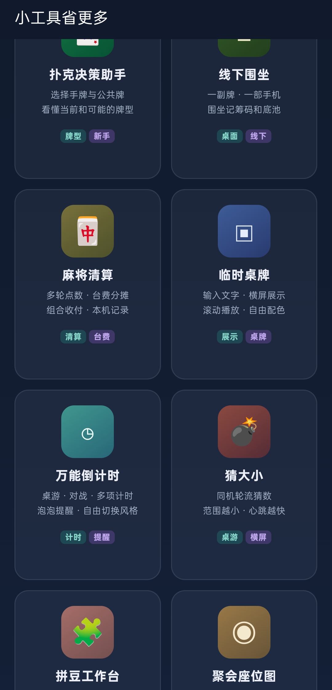
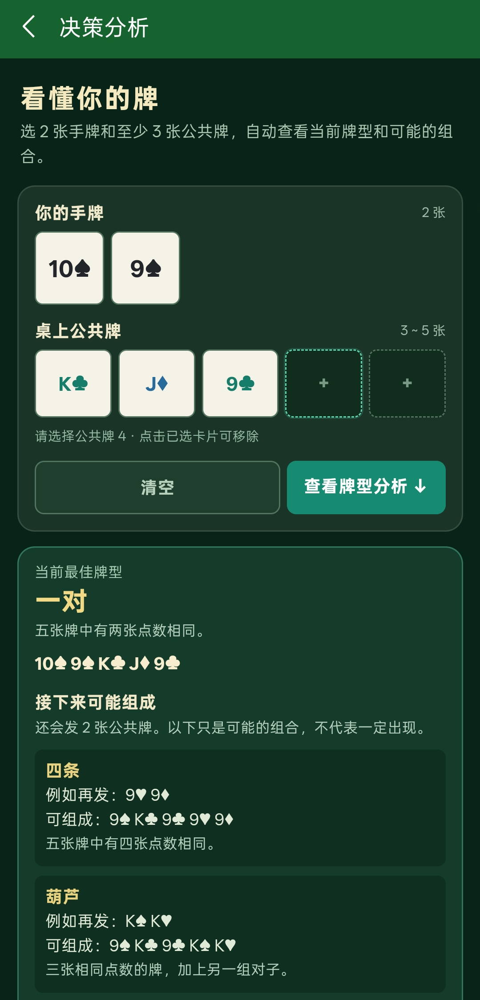
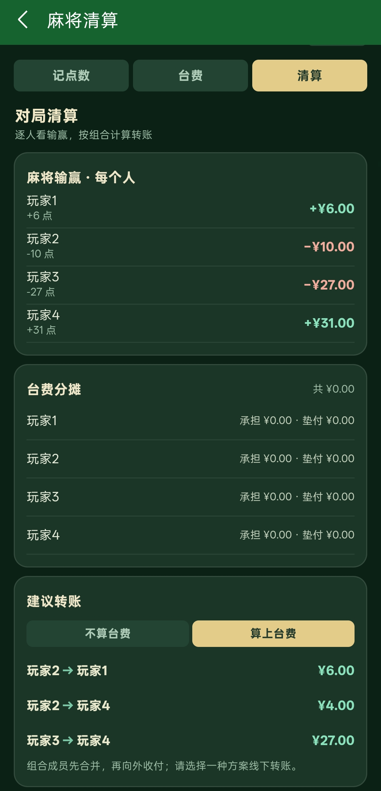
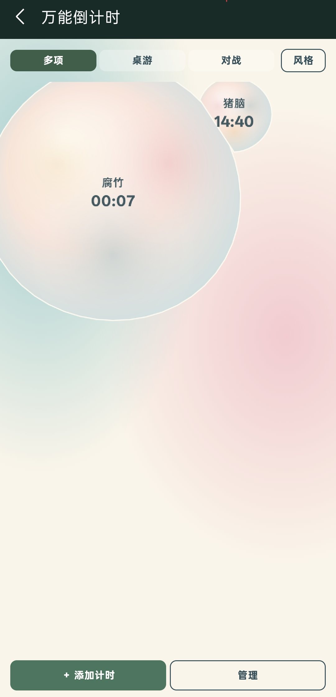
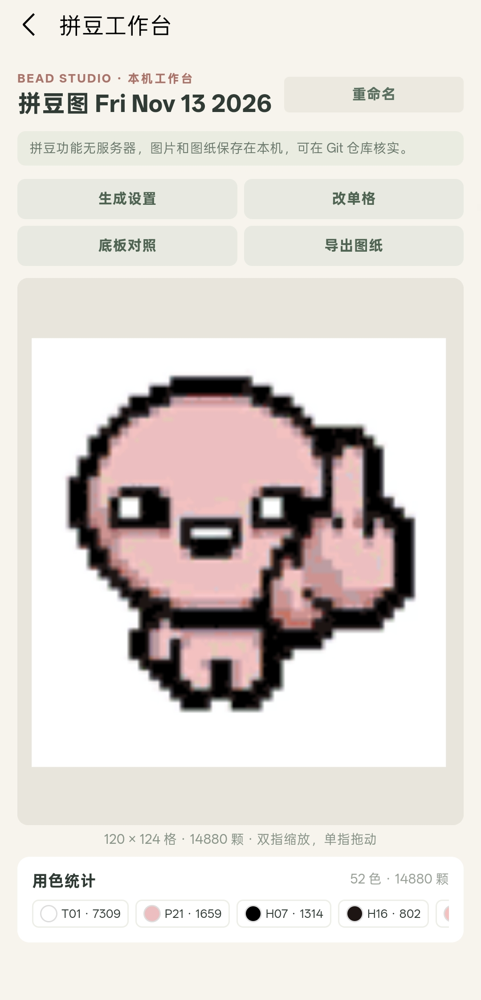
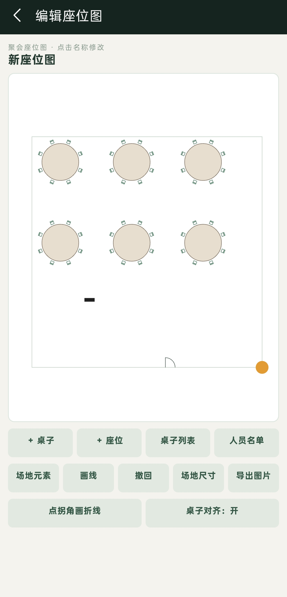
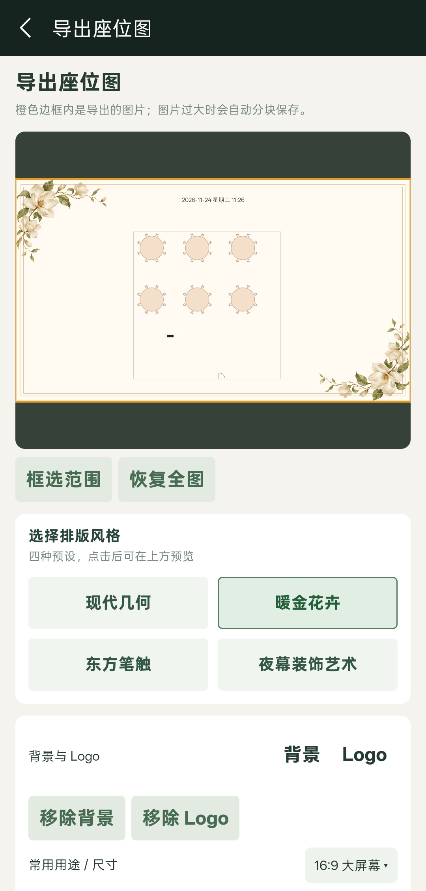
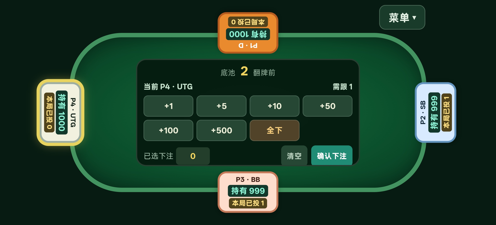
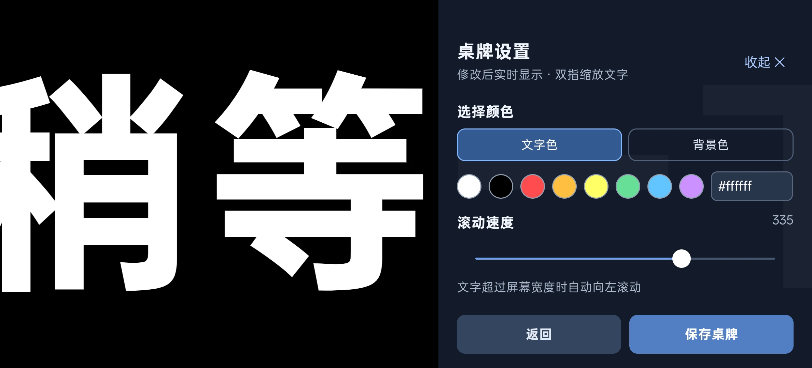
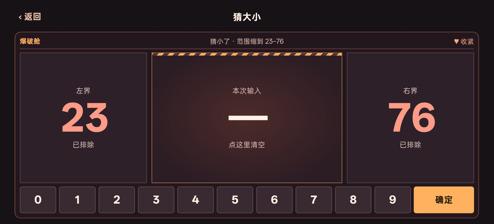

<div align="center">


# 小工具省更多

### 小巧 · 顺手 · 不费脑

一些随手就能用的工具，装进同一个小程序和 Android 应用。

[](https://github.com/zhoudeye716-wq/Small_utilities_save_much_effort)
[](https://gitee.com/bigpoint/Small_utilities_save_much_effort)
[](https://gitee.com/bigpoint/Small_utilities_save_much_effort/releases)
[](./LICENSE)

</div>

---

## 工具一览

| 工具 | 可以做什么 |
| --- | --- |
| 🃏 扑克决策助手 | 输入手牌和公共牌，查看当前牌型与可能组成的牌型。 |
| ♣️ 线下围坐 | 用一副实体牌和一台设备记录筹码，也可通过局域网围坐。 |
| 🀄 麻将清算 | 记录每轮点数、分摊台费，查看个人盈亏和转账建议。 |
| 🪧 临时桌牌 | 用手机或平板展示文字，支持滚动、缩放和颜色设置。 |
| ⏱️ 万能倒计时 | 桌游、对战和多项计时，多项计时以泡泡展示。 |
| 🎯 猜大小 | 在同一设备上轮流猜数字，逐步缩小范围。 |
| 🧩 拼豆工作台 | 将图片生成拼豆图纸，编辑色号、对照底板并导出。 |
| 🪑 聚会座位图 | 自由布置场地、桌椅和人员，生成适合展示或打印的座位图。 |

首页还提供「数据备份与恢复」；「数据看板」「快捷笔记」暂未开放。

## 界面预览

### 首页与竖屏工具

<table>
  <tr>
    <td align="center"><strong>工具首页</strong><br /><a href="./docs/screenshots/01-home.jpg"></a></td>
    <td align="center"><strong>扑克决策助手</strong><br /><a href="./docs/screenshots/02-poker-analysis.jpg"></a></td>
  </tr>
  <tr>
    <td align="center"><strong>麻将清算</strong><br /><a href="./docs/screenshots/04-mahjong-settlement.jpg"></a></td>
    <td align="center"><strong>万能倒计时</strong><br /><a href="./docs/screenshots/06-timer-bubbles.jpg"></a></td>
  </tr>
</table>

<p align="center"><strong>拼豆工作台</strong><br /><a href="./docs/screenshots/08-perler-editor.jpg"></a></p>

<table>
  <tr>
    <td align="center"><strong>座位图编辑</strong><br /><a href="./docs/screenshots/09-seating-editor.jpg"></a></td>
    <td align="center"><strong>座位图导出</strong><br /><a href="./docs/screenshots/10-seating-export.jpg"></a></td>
  </tr>
</table>

### 横屏工具

<p align="center"><strong>线下围坐</strong><br /><a href="./docs/screenshots/03-offline-table.jpg"></a></p>

<p align="center"><strong>临时桌牌</strong><br /><a href="./docs/screenshots/05-signboard.jpg"></a></p>

<p align="center"><strong>猜大小</strong><br /><a href="./docs/screenshots/07-guess-size.jpg"></a></p>

> 本工程根据已发布版本的页面截图和使用说明重新搭建，原始工程和原版决策算法无法完整恢复。

## 功能

### 扑克决策助手

- 选择两张手牌和 3–5 张公共牌，自动查看当前最佳五张牌及其牌型说明；添加或更换牌时自动更新。
- 公共牌尚未发完时，展示最多五种可能组成的更大牌型及示例牌面。
- 可能组合取决于后续发牌；实际胜负还要比较其他玩家的牌。

### 线下围坐

- 支持 2–9 人，按人数显示庄家、盲注及其他座位，座位文字朝向桌边玩家。
- 自动记录盲注、持有筹码、下注和底池；支持跟注、过牌、弃牌、加注和全下。
- 支持主池、边池和多人平分；实体牌由玩家自行发放、比牌，并在摊牌时选择赢家。
- 支持补充筹码、重置牌桌和继续保存在本设备的牌局。自动进入下一局时保留庄家位置。
- 右上角可查看逐人盈亏及转账建议；尚未分配的底池在预览中暂按各人投入退回，不改变正在进行的牌局。
- 可在设置页进入局域网围坐。房主建房并设置筹码，其他人搜索、加入并选择座位；每人只操作自己的位置，房主负责设置庄家、补筹和选择赢家。

### 麻将清算

- 新建对局可使用三步新手引导，选择在场和上场玩家、初始点数、单价及选填的台费；引导开关保存在本机。
- 记录多轮剩余点数，可中途新增玩家；支持负数，并在每轮检查点数是否平衡。新对局每轮为 3 人或 4 人，旧对局保留原规则。
- 分别记录在场和本轮上场；人员可离场、再次到场并调整时间。每笔台费记录垫付人及起止时间，按在场时间分摊，支持跨日和整场台费手动调整。
- 逐人查看麻将输赢，可设置多个组合；每名玩家最多加入一个组合，计算转账时合并组合成员的净额。
- 切换查看不含台费或包含台费的转账建议；实际付款由玩家在线下完成。
- 玩家昵称可在本机复用，并可分别设置今天是否在场和本小轮是否上场。
- 在麻将对局记录页可统一管理本机玩家和组合；按同一玩家的身份同步昵称和当前组合到已有对局，删除后重新创建的同名玩家属于新身份。
- 对局及未完成输入自动保存在当前设备；清算页可保存当时的输赢和日期，之后从对局记录查看。
- 可在对局记录中管理并删除对局，删除需要两次确认；本机玩家昵称名单会保留。

### 临时桌牌

- 输入单行或多行文字，默认横屏，也可选择跟随设备旋转；短文字居中，超出屏幕时向左循环滚动。
- 双指缩放文字，设置文字及背景颜色、滚动速度和动态颜色；点按展示区域可打开或收起设置。
- 手动保存桌牌到当前设备，可再次打开、修改或删除；展示时请求保持屏幕常亮。
- 字体使用设备可用的粗黑体，实际字形和屏幕方向表现可能因设备而异。

### 万能倒计时

- 桌游计时支持点按重置和最后九秒提示；对战计时支持双方轮流计时和暂停。
- 多项计时支持命名、三个可设置的快捷时长、暂停与恢复；到期后逐项显示提醒，页面在前台时重复播放提示音并振动。
- 可切换十种视觉风格，计时设置与状态保存在本机。暂停的泡泡在底部可左右滑动；运行中的泡泡区域可上下滑动。
- 计时使用设备时间。离开小程序后不能保证继续响铃或振动，返回后会按实际经过的时间补算，并显示已超时的计时。

### 猜大小

- 猜大小支持同一设备轮流猜数、自定义范围、本机续局、声音和震动；目标数字及范围边界按页面设置生成。

### 拼豆工作台

- 从相册选择图片后先裁剪，默认居中选取最大正方形，也可自由调整范围；保留原图副本，之后可以重新裁剪。
- 默认适配 52×52 底板与 MARD 221 色；支持常见图纸规格及多种套装色数，高级选项可调整格数和选择其他色数。具体色号请对照实际套装；特殊效果色在屏幕上的显示仅供参考。
- 支持主色或平均色采样、相近色合并与单格修改；长方形图纸保持裁剪比例并以所选规格限制最长边。
- 多份项目及图片副本保存在本机，编辑时自动保存；删除项目会删除项目文件及其本机图片副本，不删除相册原图或已导出的图片。
- 底板对照模式可双指缩放、滚轮微调柱距，分别锁定比例和位置；可在本设备保存多份命名比例。屏幕物理尺寸需手动校准，不同设备之间不会自动通用。
- 导出支持格内色号、色号统计、水平镜像、坐标、格线和大图正方形分块；图片保存到相册时需要对应系统授权。
- 拼豆功能无服务器，图片和图纸在本机处理保存。应用的其他功能（例如局域网联机和 Android 更新）仍会使用网络；清除数据或卸载可能删除本机项目。

本功能参考并使用了 [Zippland/perler-beads](https://github.com/Zippland/perler-beads) 的色号映射和图像处理思路，以及 [xiaodengaikeji/pindou](https://github.com/xiaodengaikeji/pindou) 的 MARD 套装色号分组，感谢原作者与贡献者。许可声明分别保留在 `vendor/perler-beads/LICENSE` 和 `vendor/pindou-presets/LICENSE`；其他色号与分组参考 [Mard Beads 色卡](https://mardbeads.com/mard-beads-color-chart)、[168 色参考](https://gogopixelbeads.com/zh/mard-color-chart/)和 [313 色参考](https://www.moneyshake.cn/academy/mard-colors)。

### 聚会座位图

- 从空白画布布置俯视场地，可选输入场地实际长宽，再按相同比例设置桌子尺寸；也可不设置实际尺寸直接拖动布局。
- 支持圆桌、方桌、椭圆桌、T 形桌和 U 形桌，设置人数和可坐的桌边，自动生成座位；可复制桌子或按行列批量生成，并调整桌边间距。
- 可添加独立座位、舞台、通道、门、墙壁及文字，也可手绘线条或点选拐角绘制区域；支持撤回、旋转和桌子水平垂直对齐。
- 支持用逗号、空格或换行批量录入姓名，手动安排座位或自动安排未入座人员；可搜索名单、查看桌子与已入座人员。
- 导出时可选择画布范围、四种排版风格、背景和 Logo，填写活动名称、日期、时间和地点，调整文字、图片比例及清晰度。
- 提供 1K、2K、4K、8K 长边档位和打印尺寸、DPI 设置；大图会按设备限制分块保存。图片素材超过原始像素放大时，装饰细节可能变软；打印前建议检查文字大小和清晰度。
- 座位图及其背景、Logo 保存在本机，也可通过数据备份迁移。该功能仍需在目标设备上验证编辑和导出效果。

### 数据备份与恢复

- 首页底部可选择备份麻将、桌牌、围坐、猜大小、拼豆和座位图数据；拼豆原图及座位图引用的图片也会打包，倒计时状态和局域网测试日志不包含在内。
- 可选 6～18 位、不能含中文的密码。加密备份使用 scrypt 和 XChaCha20-Poly1305；密码无法找回。不设密码时，持有备份文件的人可以读取其中的数据和图片。
- 备份先写入应用本机目录，列表中的「导入」可直接读取本软件保存的备份。多端应用优先调用 `wx.miniapp.chooseFile` / `wx.miniapp.shareFile`；微信小程序使用聊天文件选择与分享接口。多端如提供「保存到设备」，调用的是 `wx.miniapp.copyWxFileToNative`，是否返回位置、文件是否可见取决于系统和 SDK，必须自行核实。不能把沙箱中的文件视作卸载后仍存在的备份。
- 导入会先检查并预览，合并相同身份的数据时让用户选择冲突版本；拼豆校准在其他设备上应重新进行，局域网快照不会自动重新连接。
- 单个备份的结构化内容与图片合计上限为约 32 MiB；图片编码会增加体积，较大项目请分批选择备份。导入过程中断后下次启动会尝试恢复导入前的数据。

添加新工具时，可在 `utils/backup/registry.js` 声明备份类别、存储键、数据类型和合并策略，并为其业务数据结构、冲突和恢复补充验证；涉及图片等文件时还需实现对应的文件采集与恢复适配。备份格式不兼容时需要调整格式版本并提供迁移。

## 使用线下围坐

1. 准备一副实体扑克牌，进入「线下围坐」，设置人数、盲注和每人的初始筹码。
2. 点击「开始新局」，将设备横放在桌面中央；已有牌局时也可以选择「继续上一局」。
3. 从右上角菜单选择「设置庄家」，再点击对应座位。盲注会自动计入底池。
4. 当前玩家可以选择「自动跟注」或「弃牌」。需要下注或加注时，选择筹码数额后点击「确认下注」；所选数额包含需要跟注的筹码。
5. 按页面提示发放实体公共牌。摊牌后自行比牌，为需要选择赢家的底池指定赢家并结算。

无需跟注时，点击「自动跟注」会过牌；筹码不足以跟注时会投入剩余筹码并全下。右上角菜单还提供补充筹码、重置牌桌、使用指南和返回设置。

### 局域网围坐

1. 所有设备连接同一 Wi-Fi 或热点，准备一副实体扑克牌。在「线下围坐」设置页点击「局域网联机围坐」。
2. 房主填写昵称、房间名、盲注、每人初始筹码与单价；房间密码按需启用。其他人填写昵称，搜索房间并加入，在空座中选好位置。
3. 至少两人入座后，房主开始对局。每个人的界面中自己的座位显示在下方；实体牌仍由大家在线下发放并比较。
4. 轮到自己时操作；房主设置庄家、补充筹码和选择底池赢家。中途加入或重新入座的玩家从下一小局开始参与。
5. 菜单中的「查看盈亏」仅供查看，不会结束对局或修改底池。断线时展示的是最近确认的数据，可能不是最新情况。

房主主动解散后，其他人可查看最后一次同步的画面并自行退出；房主意外退出后，再次建房时可选择恢复最近的未结束房间。昵称、房间名和最近房间数据保存在本机；覆盖更新需系统保留应用数据且包名、签名一致。卸载或清除数据可能导致记录丢失。

玩家在房主离线时退出，本机无法立即通知房主；需要房主恢复连接后在成员管理中确认该玩家离场。特殊情况下，如果离场会导致边池没有合格赢家，系统会拒绝该操作并提示先完成本小局结算。旧单机牌局若缺少累计补筹记录，无法可靠计算盈亏；开始新局后即可使用。

局域网搜索和后台恢复受设备、网络及系统限制；搜索不到时可先在系统 Wi-Fi 设置中查看房主的局域网 IP，再使用大厅内的地址查询。房间密码用于限制普通加入，数据传输未加密，应仅在可信网络中使用，也不要把常用密码作为房间密码。联机功能尚需在参与设备上进行真机验证。

## 本地开发

本项目采用 [GNU AGPL-3.0](LICENSE)；历史版本此前已按 Apache-2.0 发布的授权不受本次调整撤销。`vendor/matter` 保留其 MIT 许可。

### 环境与导入

- 安装微信开发者工具。
- 导入本仓库根目录，即 `project.config.json` 所在目录。
- 在开发者工具中确认项目 AppID；上传到自己的小程序时，使用对应小程序的 AppID。
- 点击「编译」，在模拟器中打开页面；也可以通过开发者工具进行真机预览。

页面使用 WXML、WXSS 和 JavaScript，由微信小程序和 Android 共用同一份源码。工程已在 `app.json` 中开启组件按需注入。无需安装 npm 依赖即可导入当前工程。

### 微信小程序与 Android

- 项目已升级为微信多端项目。微信小程序配置位于 `project.config.json` 和 `app.json`；多端 App 配置位于 `project.miniapp.json`、`app.miniapp.json` 和 `i18n/`。
- 开发者工具可分别切换小程序及多端应用模式进行编译、预览和测试。共享源码不代表平台接口完全一致，页面、存储、音频、传感器、横屏和局域网通信均需在相应平台验证。
- Android 图标位于 `miniapp/android/icons/`，在多端配置中按屏幕密度引用。
- Android 测试或正式打包需要按开发者工具提示准备签名证书。正式发布请妥善备份包名、签名密钥和口令；密钥不能提交到仓库，临时调试证书不应用作正式更新签名。
- 小程序和 Android 应用分别构建、测试和发布；两端各自的本机数据不会自动同步。Android App 冷启动时检查公开 Gitee 发行版，用户可查看当前版本、更新说明及下载进度，再由系统确认安装；推送源码不会自动生成安装包。
- 局域网功能使用 UDP。Android 多端配置开启了 Network 扩展 SDK；搜索、断线恢复及本机 IP 获取表现需在实际设备和网络上验证。
- 本地 Android 测试包可放在 `debug/`；该目录不进入 Git 和小程序代码包。

当前配置中的 Android `targetSdkVersion` 为 34。正式发布前，应检查开发者工具实际使用的包名、签名、目标 SDK 和安装包权限，并在目标设备上测试；权限声明不代表运行时已经获得授权。

### Android 发行版更新

Android 更新信息和安装包发布在 [Gitee 镜像仓库的发行版](https://gitee.com/bigpoint/Small_utilities_save_much_effort/releases)；[GitHub 原仓库](https://github.com/zhoudeye716-wq/Small_utilities_save_much_effort)用于维护源码。源码镜像和发行版附件是否同步，以 Gitee 上实际显示的发行版为准。

每次发布新版时递增 `project.miniapp.json` 的 `version` 和 `versionCode`，保持应用包名及签名证书不变。在发布仓库创建与应用版本对应的正式发行版，例如应用为 `1.2.6` 时使用 `v1.2.6` 标签，填写更新说明，并上传一个 APK 附件。更新检查只识别三段式版本、非草稿且非预发布的发行版，并要求有且仅有一个符合仓库地址规则的 APK 附件。App 使用多端 `host.appVersion` 对比版本，用户需要确认系统安装。更换包名或签名会导致无法覆盖安装，卸载旧版可能丢失本机数据。

桌牌列表使用 `styles/adaptive.wxss` 中的可复用页面容器和主操作样式：页面可按需引入，并使用 `adaptive-page`、`adaptive-action` 等类。手机和大屏使用不同的间距与字号规则；其他页面需要接入并分别检查实际布局。

### 项目结构

```text
├── app.js / app.json / app.wxss    小程序入口与全局配置
├── styles/adaptive.wxss             可复用的页面与主操作样式
├── pages/
│   ├── home/                       首页
│   ├── analyzer-setup/             旧版决策助手设置页面
│   ├── analyzer/                   决策分析页面
│   ├── analyzer-guide/             决策助手指南
│   ├── offline-setup/              线下围坐设置
│   ├── offline-table/              线下围坐牌桌
│   ├── offline-guide/              线下围坐指南
│   ├── lan-poker-lobby/            局域网围坐大厅
│   ├── mahjong-history/            麻将对局记录
│   ├── mahjong-guide/              麻将新手引导
│   ├── mahjong-session/            麻将点数、台费与清算
│   ├── mahjong-people/             本机玩家和组合管理
│   ├── signboard-list/             桌牌本机记录
│   ├── signboard/                  横屏桌牌展示与设置
│   ├── timer/                      万能倒计时
│   ├── guess-size/                 猜大小
│   ├── perler-list/                拼豆项目列表
│   ├── perler-editor/              拼豆编辑与导出
│   ├── seating-list/               座位图项目列表
│   ├── seating-editor/             场地、桌椅和人员编辑
│   ├── seating-export/             座位图预览与导出
│   ├── data-backup/                数据备份与恢复
│   └── lan-test/                   局域网联机测试
├── utils/
│   ├── cards.js                    扑克牌数据
│   ├── decision.js                 牌型比较与旧版决策计算
│   ├── hand-analysis.js            当前牌型和可能组合分析
│   ├── mahjong.js                  麻将点数、台费和转账计算
│   ├── mahjong-roster.js           本机玩家和组合名单
│   ├── mahjong-records.js          清算记录快照
│   ├── signboard-storage.js        桌牌本机存储
│   ├── offline-table.js            围坐牌局规则与结算
│   ├── table-layout.js             座位布局
│   ├── storage.js                  本地存储
│   ├── timer-bubbles.js            泡泡绘制与碰撞
│   ├── guess-size.js               猜大小规则与存档
│   ├── perler/                     拼豆色板、图纸和导出
│   ├── seating/                    座位图模型、布局和导出
│   ├── backup/                     备份格式与恢复适配
│   ├── lan-poker/                  局域网围坐协议与同步
│   └── lan-test/                   局域网协议、房间和统计
├── components/mahjong-time/        台费日期和时间选择器
├── vendor/matter/                  Matter.js 物理引擎及 MIT 许可
└── tests/                          牌局规则、页面和布局测试
```

### 运行测试

测试使用 Node.js 内置测试运行器，在项目根目录执行：

```bash
node --test tests/*.test.js
```

## 问题反馈与功能建议

欢迎通过 [GitHub Issues](https://github.com/zhoudeye716-wq/Small_utilities_save_much_effort/issues) 或 [Gitee Issues](https://gitee.com/bigpoint/Small_utilities_save_much_effort/issues) 提交反馈，创建时可选择 Bug 反馈、功能建议、使用体验或文档改进模板。

## 数据与恢复说明

设置和牌局状态保存在当前设备的应用本地存储中，不会自动同步到其他设备，也不会在微信小程序和 Android App 之间自动互通。返回设置时会保存当前牌局；尚未确认的下注不会保存。开始新局会在确认后替换已保存的围坐牌局；清除应用数据或卸载也可能使缓存丢失。

原始工程及其文件结构、注释和策略算法无法从截图完整还原。本仓库记录的是根据现有资料重新搭建并继续维护的版本。
